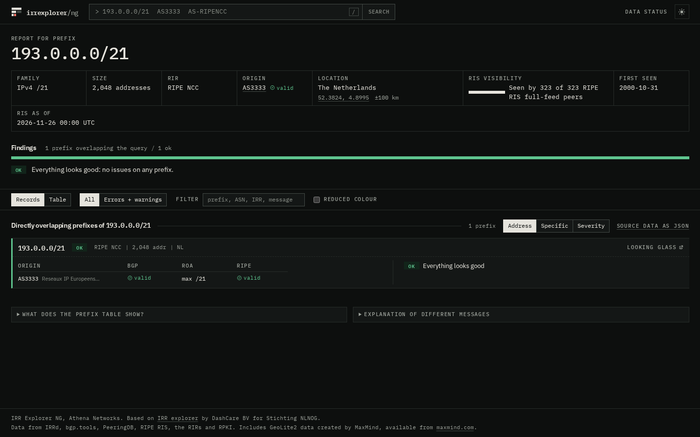
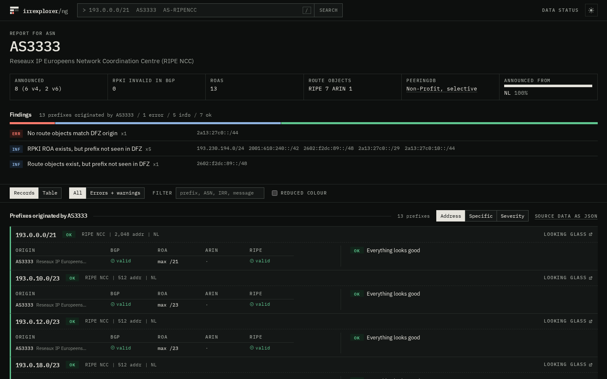
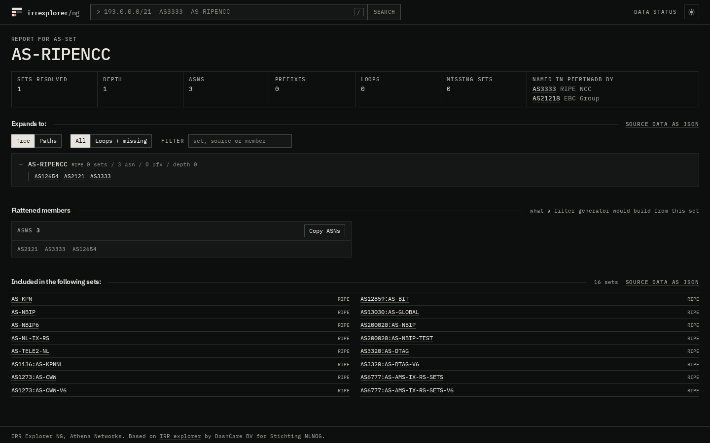

# IRR Explorer NG

IRR Explorer NG puts the routing registry, RPKI and the global routing table side by side for
a prefix, an AS number or an AS-set, and shows you where they disagree. Look up a prefix and
you see who originates it in BGP, which route objects exist for it in each IRR, whether a ROA
covers it, and a plain-language finding for every mismatch.

It is a rewrite of [IRR explorer](https://github.com/nlnog/irrexplorer) by DashCare BV for
Stichting NLNOG. Every view, column and status message of the original is still here, along
with its JSON API. On top of that it adds RPKI validity for BGP origins, loop and missing-member
detection in set expansion, PeeringDB and GeoLite2 enrichment, and pages that keep working when
one of the data sources is down.



## What you can look up

- **A prefix or an IP address**, for example `/prefix/193.0.0.0/21` or `/prefix/193.0.0.1`.
  Every prefix overlapping the query with its RIR, BGP origins, ROAs, route objects per IRR,
  RIPE RIS visibility, location, and the findings for each. An address on an internet exchange
  peering LAN shows the exchange and the network whose port uses it.
- **An AS number**, for example `/asn/AS3333`. The prefixes it originates in BGP, in RPKI and in
  the IRR, the overlapping prefixes of other networks, the AS-sets and route-sets that include
  it, and its PeeringDB record: exchanges, facilities, public contacts and max-prefix values
  checked against what it actually announces.
- **An AS-set or route-set**, for example `/as-set/AS-RIPENCC`. Recursive expansion as a tree
  with depth and path for every set, markers for loops, sets that do not exist and truncation,
  the flattened ASN and prefix lists a filter generator would build, and the sets that include
  it.

Every page is a plain link that works on a full page load, and the view, filters, sort order
and theme all live in the URL, so a link shows exactly what you were looking at.





## Quick start

With Docker:

```sh
git clone https://github.com/JoshFinlayAU/irrexplorer-ng.git
cd irrexplorer-ng
cp .env.example .env    # set BGPTOOLS_USER_AGENT, see below
docker compose up -d --build
```

Then open http://localhost:3000. The first start downloads the bulk datasets (the bgp.tools
table, RIR delegations, PeeringDB and optionally GeoLite2), which takes a few minutes. Pages
work in the meantime and say which data is still loading.

Without Docker you need Node 26 and pnpm 11:

```sh
pnpm install
cp .env.example .env
pnpm dev                # development server on http://localhost:3000
pnpm build && pnpm start    # production build
```

## Data sources

Nothing is stored in a database. IRRd and RIPEstat are queried per request, and the bulk
datasets are held in memory and refreshed on a schedule. Setting `BULK_CACHE_DIR` keeps the raw
downloads on disk so a restart does not fetch them again.

| Data                                | Source                              | How                                               |
| ----------------------------------- | ----------------------------------- | ------------------------------------------------- |
| Route objects, sets, set membership | IRRd GraphQL (`IRRD_GRAPHQL_URL`)   | Queried per request                               |
| RPKI ROAs and validity              | IRRd's `RPKI` source                | Queried per request, validated locally (RFC 6811) |
| BGP origins                         | bgp.tools `table.jsonl`             | Downloaded every 2 hours                          |
| AS names                            | bgp.tools `asns.csv`                | Downloaded daily                                  |
| RIR per prefix                      | NRO delegated stats and Registro.BR | Downloaded daily                                  |
| RIS visibility, BGP fallback        | RIPEstat Data API                   | Queried per request                               |
| Geolocation (optional)              | MaxMind GeoLite2 City               | Checked every 6 hours, downloaded when updated    |
| Networks, exchanges, facilities     | PeeringDB API                       | Mirrored: changes hourly, full copy daily         |

Things worth knowing before you deploy:

- **IRRd.** Any IRRd 4 instance with GraphQL works. The default is NTT's public server,
  `https://rr.ntt.net/graphql/`. For RPKI columns the IRRd needs RPKI import enabled, which
  gives it a pseudo-source called `RPKI`; without one, RPKI shows as unavailable rather than
  "not found". Queries always ask for RPKI-invalid objects explicitly, because IRRd's ROV filter
  would otherwise hide them. If you expect heavy use, run your own IRRd rather than leaning on a
  public one.
- **bgp.tools** asks every client for an identifying User-Agent with a contact address and no
  more than one table download every 30 minutes. Set `BGPTOOLS_USER_AGENT`, for example
  `my-irrexplorer bgp.tools - noc@example.net`. Without it the table is not downloaded and BGP
  origins come from RIPE RIS instead.
- **GeoLite2** needs a free MaxMind account. Set `MAXMIND_ACCOUNT_ID` and
  `MAXMIND_LICENSE_KEY` to turn location on. The app checks for a new release with a HEAD
  request, which does not count against MaxMind's download limit, and downloads only when the
  database has changed.
- **PeeringDB** works without a key. An API key (`PEERINGDB_API_KEY`) raises the query limit
  from 20 to 40 a minute. Only contacts that PeeringDB shows publicly are kept, since this app
  shows its data to anyone who can reach it.
- **Partial failure.** If a source is down, the page still renders with a notice naming what
  is missing. Checks that depend on missing data are skipped and say so, rather than reporting
  that everything looks fine.

## Configuration

Every setting is documented in [`.env.example`](.env.example). The ones you are most likely to
change:

| Variable                       | Default                       | Purpose                                     |
| ------------------------------ | ----------------------------- | ------------------------------------------- |
| `IRRD_GRAPHQL_URL`             | `https://rr.ntt.net/graphql/` | IRRd GraphQL endpoint                       |
| `BGPTOOLS_USER_AGENT`          | empty                         | Required for the bgp.tools table download   |
| `RIPESTAT_SOURCEAPP`           | `irrexplorer-ng`              | Sent on every RIPEstat call                 |
| `MAXMIND_ACCOUNT_ID`           | empty                         | MaxMind account, for GeoLite2               |
| `MAXMIND_LICENSE_KEY`          | empty                         | MaxMind licence key, for GeoLite2           |
| `PEERINGDB_API_KEY`            | empty                         | Optional, raises PeeringDB's query limit    |
| `PEERINGDB_ENABLED`            | `true`                        | Set to `false` to leave PeeringDB out       |
| `BULK_CACHE_DIR`               | empty                         | Keep bulk downloads on disk across restarts |
| `PORT`                         | `3000`                        | HTTP port                                   |
| `CACHE_TTL_SECONDS`            | `600`                         | In-process cache for upstream responses     |
| `CACHE_MAX_MB`                 | `256`                         | Size cap for that cache                     |
| `UPSTREAM_TIMEOUT_MS`          | `8000`                        | Per-call timeout (IRRd gets at least 15 s)  |
| `IRRD_BULK_TIMEOUT_MS`         | `60000`                       | Large IRRd lookups (big ASNs and sets)      |
| `SET_SIZE_LIMIT`               | `1000`                        | Stop set expansion beyond this many sets    |
| `MIN_PREFIX_LENGTH_V4` / `_V6` | `9` / `29`                    | Shorter queries are refused as too large    |

## Running in production

The Docker image is a two-stage build on `node:26-alpine` that ships only the built server,
runs as an unprivileged user under tini and listens on port 3000. The compose file mounts a
volume for `BULK_CACHE_DIR`.

- `GET /healthz` reports the process, its memory use, and the last success and failure for
  every upstream and dataset. It never calls an upstream, so it is safe for frequent probes.
- With every dataset loaded the process uses about 550 MB. Very large ASNs (AS13335, AS16509)
  can push it to about 1.4 GB, and the image sets a 2 GB heap limit. Those pages can take a
  while on a cold cache, because every aggregate the ASN announces needs an IRRd overlap
  lookup. The original IRR Explorer has the same cost, and a nearby IRRd makes a large
  difference.
- Calls to IRRd and RIPEstat are limited to 12 and 8 at a time. Responses are gzip-compressed
  and carry basic security headers.
- The app has no login. Put it behind your own access control if it should not be public.

## JSON API

The original IRR Explorer API is kept, so existing tools keep working:

- `GET /api/clean_query/<query>`
- `GET /api/prefixes/prefix/<prefix>`
- `GET /api/prefixes/asn/AS<n>`
- `GET /api/sets/member-of/<as-set|route-set>/<target>`
- `GET /api/sets/expand/<set>`
- `GET /api/metadata/`

Field names match the original. `rpslText` is null because object text is fetched on demand,
and each prefix summary also carries the extra NG data under `ng`.

## Development

Built with TanStack Start, Router, Query, Table, Form and Virtual, TypeScript in strict mode,
Zod at every upstream boundary, and Tailwind CSS 4.

```sh
pnpm typecheck          # tsc --noEmit
pnpm lint               # eslint and prettier --check
pnpm test               # Vitest: unit, component and service tests
pnpm test:e2e           # build, then Playwright in Chromium, Firefox, WebKit and two phones
pnpm test:live          # Playwright against the real upstreams (needs pnpm dev running)
```

No test needs the network. The unit tests serve recorded upstream responses from
`test/fixtures/` through MSW. The end-to-end suite starts a mock of every upstream
(`e2e/mock-upstreams.ts`) that replays the same recordings, plus two app instances, one healthy
and one with every source but RIPEstat failing. Every screen is loaded as a direct link and
through client-side navigation, in light and dark themes, and checked for console errors,
hydration warnings and axe accessibility violations.

To refresh the fixtures, run the dev server once with `BULK_CACHE_DIR=.cache` so the bulk
downloads are on disk, then run `pnpm fixtures:record`. It records every request the suite
makes and trims the bulk dumps to the rows the tests use.

Where things live:

- `src/lib/` holds framework-free code: prefix handling (`ip.ts`), input parsing (`parse.ts`),
  the in-memory prefix index, and `analysis/`, which merges the sources and produces the
  findings, RPKI validation and set expansion. Most unit tests sit next to it.
- `src/server/sources/` has one module per upstream, each validating responses with Zod.
- `src/server/services/` combines the sources for each view and handles partial failure.
- `src/server/functions.ts` holds the server functions, the only path from the browser to
  upstream data.
- `src/routes/` holds the file routes, including `/healthz` and the JSON API.
- `src/components/` holds the interface.

## Credits

Based on [IRR explorer](https://github.com/nlnog/irrexplorer) by DashCare BV for Stichting
NLNOG. Built by Athena Networks.

BGP data from [bgp.tools](https://bgp.tools) and [RIPE RIS](https://ris.ripe.net). Network,
exchange and facility data from [PeeringDB](https://www.peeringdb.com), used under its
[acceptable use policy](https://www.peeringdb.com/aup).

This product includes GeoLite2 data created by MaxMind, available from
[https://www.maxmind.com](https://www.maxmind.com).
